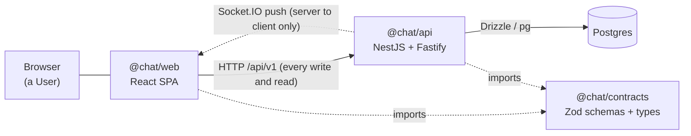
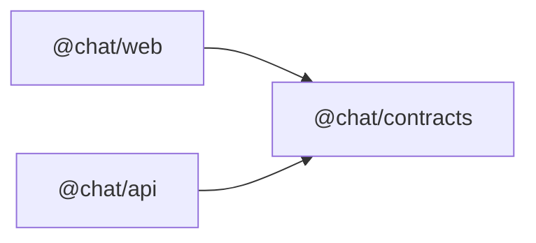

# Architecture overview

How the pieces fit together today. Hand-written from the code; if this page and the code disagree, the code wins and this page is the defect. The runtime sequences are in [runtime-flows.md](runtime-flows.md).

## Context

- The browser runs the web app. The web app talks to the API over HTTP under `/api/v1` and holds one Socket.IO connection that only receives pushes ([ADR 0001](../adr/0001-websocket-is-server-push-only.md)).
- In development the Vite server proxies `/api` and `/socket.io` to the API on port 3000 (`packages/web/vite.config.ts`), so the web app always calls its own origin. The API's CORS allows only the configured `SPA_ORIGIN` (`packages/api/src/app.ts`).
- How the web app is served and how `/api` and `/socket.io` are routed in production is not decided yet; the human will choose when deploying. The dev proxy is the only documented topology.
- Postgres is reached only by the API. The web app never touches it.
- Contracts is the shared seam: the request, response and push-event shapes both sides validate against. Neither side defines these shapes on its own.

## What each package owns

| Package           | Owns                                                                                                                                                                                                             |
| ----------------- | ---------------------------------------------------------------------------------------------------------------------------------------------------------------------------------------------------------------- |
| `@chat/contracts` | Zod schemas and inferred types for HTTP bodies, error codes and Socket.IO events (`packages/contracts/src/`). No dependency on either app.                                                                       |
| `@chat/api`       | HTTP routes, auth (sessions, tokens), Conversation and Message rules, Group lifecycle, the Socket.IO gateway, and the database schema and migrations (`packages/api/src/db/schema.ts`, `packages/api/drizzle/`). |
| `@chat/web`       | The single-page app: routing, the session held in memory, the Conversation list and view, and the Socket.IO client (`packages/web/src/`).                                                                        |

The API is split into feature modules (`auth`, `messages`, `groups`, `memberships`, `realtime`, `health`, plus shared infrastructure such as `db`, `clock`, `logging` and `throttling`) as decided in [ADR 0007](../adr/0007-api-feature-modules-and-nestjs-drizzle.md). It runs as a single process ([ADR 0006](../adr/0006-api-runs-as-a-single-instance.md)).

## Dependency direction

Both apps depend on contracts; contracts depends on neither; the apps do not depend on each other. The machine-generated version of this graph is [package-graph.md](package-graph.md).

## Where to look instead of reading prose

| Question                                     | Doc                                       |
| -------------------------------------------- | ----------------------------------------- |
| Which HTTP routes exist, and which need auth | [http-routes.md](http-routes.md)          |
| What a push event carries                    | [realtime-events.md](realtime-events.md)  |
| Tables and relations                         | [er-diagram.md](er-diagram.md)            |
| Why a decision was made                      | [adr-index.md](adr-index.md), `docs/adr/` |
| Chat terms                                   | [GLOSSARY.md](../../GLOSSARY.md)          |
