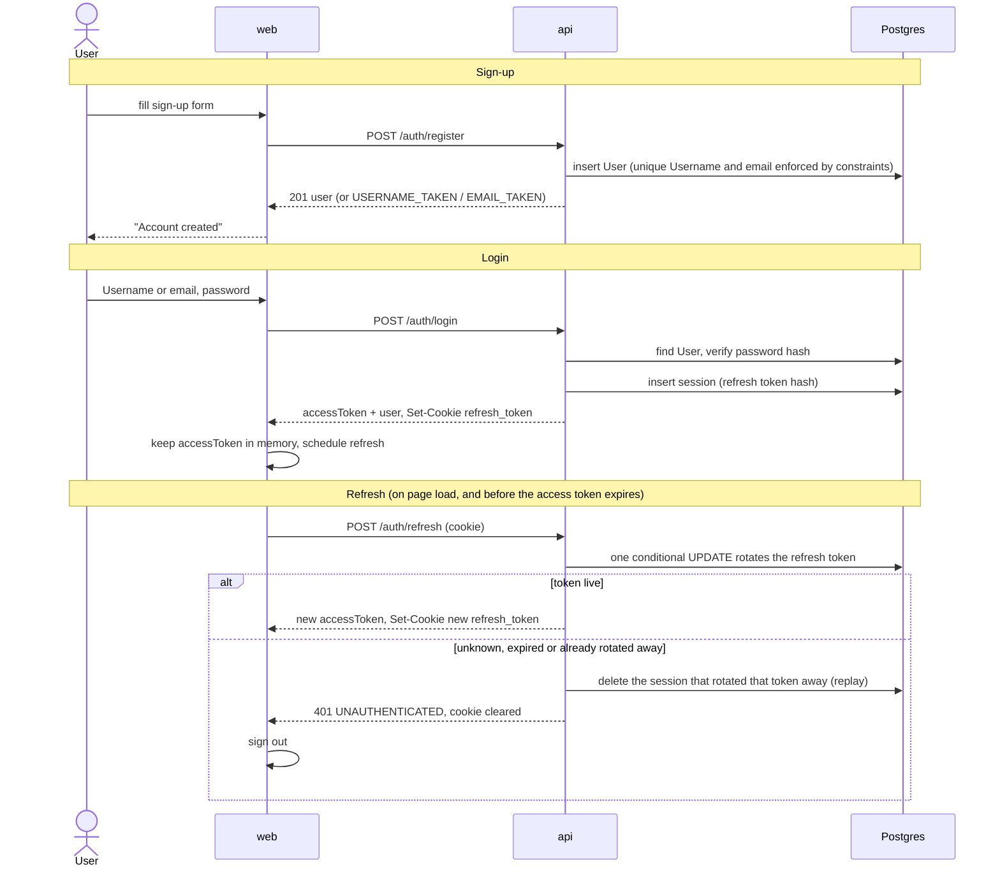
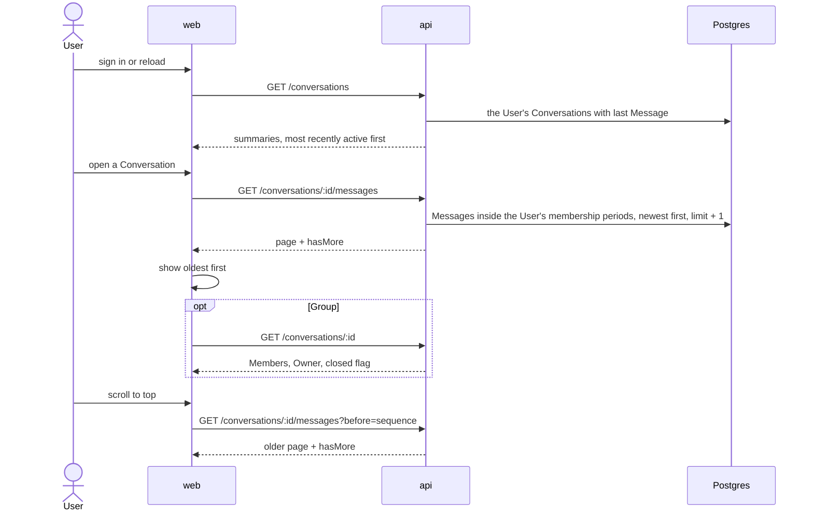

# Runtime flows

How the main paths run today. Hand-written from the code; if this page and the code disagree, the code wins and this page is the defect. Context and package ownership are in [overview.md](overview.md). Route lists, event payloads and tables are not repeated here: see [http-routes.md](http-routes.md), [realtime-events.md](realtime-events.md) and [er-diagram.md](er-diagram.md).

## Sign-up, login and session refresh

Sign-up only creates the User; it does not sign them in. Login returns a short-lived access token in the body and sets the refresh token as a cookie. The web app keeps the access token only in memory (`AuthProvider`), so on every page load it first trades the cookie for an access token.



Facts worth knowing, each from the code:

- The refresh cookie is `httpOnly`, `secure`, `sameSite=strict`, scoped to path `/api/v1/auth` (`packages/api/src/auth/auth.controller.ts`).
- Access tokens are EdDSA JWTs carrying a session ID (`sid`); refresh tokens are opaque random values stored only as a hash (`packages/api/src/auth/token.service.ts`).
- A request is accepted only if the token verifies, is not on the deny-list, and its session still exists (`access-token-authenticator.ts`). Logout denies the token and deletes the session, then pushes `session.revoked` to that session's sockets so its other tabs sign out.
- Token lifetimes come from `ACCESS_TOKEN_TTL_SECONDS` and `REFRESH_TOKEN_TTL_DAYS` in `packages/api/src/config/config.ts`.

## Opening the socket

The web app connects one Socket.IO socket (WebSocket transport, MessagePack) once a component subscribes, authenticating with the current access token in the handshake (`packages/web/src/realtime/socket-realtime.ts`). The API checks the token with the same authenticator as HTTP, then joins the socket to rooms for the User, the session, and each Group the User is a current Member of (`packages/api/src/realtime/realtime.gateway.ts`). Group rooms are re-checked against the database after joining so a membership change committed during the handshake is not missed. The access token is checked only at connect; a token that expires later does not close the socket.

## Sending a Message

HTTP carries the write; the socket only delivers the result ([ADR 0001](../adr/0001-websocket-is-server-push-only.md)). The sender gets the Message in the HTTP response and, like every Member, also over the socket; the web app merges the two by ID.

```mermaid
sequenceDiagram
  actor S as Sender
  participant W as web
  participant A as api
  participant D as Postgres
  participant R as Members' sockets

  S->>W: type and send
  W->>W: show as pending Outgoing, new clientMessageId
  W->>A: POST /conversations/:id/messages (Bearer token)
  A->>A: AuthGuard, throttle, validate body (contracts schema)
  A->>D: BEGIN, lock Conversation row
  A->>D: require sender is a Member
  A->>D: bump last_sequence, insert Message (sequence)
  alt clientMessageId already used by this sender
    A->>D: roll back
    A-->>W: 200 original Message (no push)
  else new
    A->>D: COMMIT
    A->>A: wait for earlier commits of this Conversation to finish their push (CommitOrder)
    A->>R: message.created (best effort; failure is logged, never fails the send)
    A-->>W: 201 Message
  end
  W->>W: replace the pending Outgoing with the stored Message
  R-->>W: message.created (all Members' tabs, sender's other tabs included)
  W->>W: merge by id, ordered by sequence
```

- The first Message to a User with no Direct Conversation goes to `POST /direct-messages` instead. The API creates the Direct Conversation in the same transaction and pushes `conversation.created` to the recipient before the Message (`packages/api/src/messages/messages.service.ts`, `sendDirect`).
- A failed send stays on screen as a failed Outgoing with a Retry that reuses the same `clientMessageId`, so a retry cannot duplicate.
- Pushes for a Group go to the Group's room; for a Direct Conversation, to each Member's User room.
- Push ordering relies on the API being a single process ([ADR 0006](../adr/0006-api-runs-as-a-single-instance.md)).
- Message text is rendered as text, never as markup ([ADR 0002](../adr/0002-validate-input-encode-output-no-sanitizer.md)).

## Loading a Conversation and its history



- A reader sees only Messages whose sequence falls inside one of their membership periods. That is how a Former Member keeps reading what they were present for and nothing later (`messages.service.ts`, `history`; table in [er-diagram.md](er-diagram.md)).
- The Conversation list keeps itself current from pushes (`conversation.created`, `message.created`). It reloads from the server when a push names a Conversation it does not list, or when a Group ends for the User (`packages/web/src/shell/ConversationList.tsx`).
- Push is best effort. After the socket reconnects, the web app reloads the list and fetches the open Conversation's Messages with `?after=` the newest sequence it holds, page by page, merging by ID (`packages/web/src/shell/ConversationView.tsx`, `useReconnected`).
