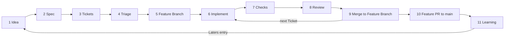

# Factory overview

How an idea becomes a merged change on `main`, and how the Factory learns from it. Terms are in the [Factory glossary](GLOSSARY.md). Each Stage has one Actor: the human, an agent (a Claude session running a skill) or a machine (a check that gives the same answer every run). A machine runs checks and never makes a decision; today a machine runs only when an agent or the human invokes it.

The other Factory docs: [Ticket lifecycle](ticket-lifecycle.md), [agent roles](agent-roles.md), [gates](gates.md), [failure modes](failure-modes.md). The per-Ticket rules are in [`docs/workflow/`](../workflow/).

## Stages

| #   | Stage                   | Actor                                                                 | What happens                                                                                                                                                 |
| --- | ----------------------- | --------------------------------------------------------------------- | ------------------------------------------------------------------------------------------------------------------------------------------------------------ |
| 1   | Idea                    | Human, or an agent appending to [Laters](../laters.md)                | An idea is written down without widening any Ticket.                                                                                                         |
| 2   | Spec                    | Agent (Spec Writer), from the human's answers                         | `grill-with-docs` or `grilling`, then `to-spec`. The Spec PR goes to `main` and the human merges it.                                                         |
| 3   | Tickets                 | Agent (Ticket Writer)                                                 | `to-tickets` writes Tickets from the [ticket template](../workflow/ticket-template.md), in the same or a follow-up PR to `main`. The human merges it.        |
| 4   | Triage                  | Human                                                                 | Sets each Ticket's Status. An agent may propose Statuses with `triage`.                                                                                      |
| 5   | Feature Branch          | Agent (Orchestrator)                                                  | Cuts the Feature Branch from `main`, per the [git workflow](../workflow/git-workflow.md).                                                                    |
| 6   | Implement               | Agent (Implementer), or the human for `ready-for-human` Tickets       | One Ticket on one Task Branch, built with `tdd`. A Ticket whose content is the human's decisions starts with a grilling session.                             |
| 7   | Checks                  | Machine, invoked by the agent                                         | `pnpm lint`, `pnpm typecheck`, `pnpm test`, and `pnpm docs:generate` with no diff.                                                                           |
| 8   | Review                  | Agent (Reviewer), then the human                                      | `code-review` on the task PR, then the human's review.                                                                                                       |
| 9   | Merge to Feature Branch | Human, or an agent (Merger) only when the human explicitly allowed it | The task PR is squash-merged into the Feature Branch.                                                                                                        |
| 10  | Feature PR to `main`    | Agent opens it, human merges                                          | When every Ticket is `resolved`. The human merges with a merge commit.                                                                                       |
| 11  | Learning                | Agent or human                                                        | Notes for later go to [Laters](../laters.md). A review comment that repeats becomes a convention. A rule broken twice gets automated. A `retro` is optional. |

What each Stage must pass before work moves on is in [gates](gates.md).
