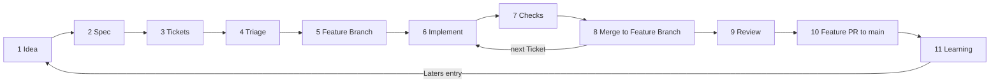

# SDLC

How an idea becomes a merged change on `main`, and how the Factory learns from it. This page is the frame: which Stages exist, who does them, when each is done and where its rules live. The rules themselves are in [`docs/workflow/`](../workflow/). Terms are in the [Factory glossary](GLOSSARY.md).

Each Stage has one Actor: the human, an agent (a Claude session running a skill) or a machine (a check that gives the same answer every run). A machine runs checks and never makes a decision; today a machine runs only when an agent or the human invokes it.

## Stages

The Gate is what must be true before work leaves the Stage. There is no CI or branch protection yet, so no Gate is checked by a machine on its own; plans are in [Laters](../laters.md).

| #   | Stage                   | Actor                                                   | Output                                                                                                                                         | Gate                                                                                                                      | Checked by | Rules                                                                                                    |
| --- | ----------------------- | ------------------------------------------------------- | ---------------------------------------------------------------------------------------------------------------------------------------------- | ------------------------------------------------------------------------------------------------------------------------- | ---------- | -------------------------------------------------------------------------------------------------------- |
| 1   | Idea                    | Human, or an agent                                      | A [Laters](../laters.md) entry, written without widening any Ticket                                                                            | None                                                                                                                      | Nobody     | [No assumptions](../workflow/no-assumptions.md)                                                          |
| 2   | Spec                    | Spec Writer, from the human's answers                   | A Spec PR to `main`                                                                                                                            | The human merged it                                                                                                       | Human      | [Git workflow](../workflow/git-workflow.md)                                                              |
| 3   | Tickets                 | Ticket Writer                                           | Tickets in the same or a follow-up PR to `main`                                                                                                | The human merged it, every template field is filled                                                                       | Human      | [Ticket template](../workflow/ticket-template.md)                                                        |
| 4   | Triage                  | Human; an agent may propose Statuses with `triage`      | Each Ticket's Status                                                                                                                           | The Ticket is `ready-for-agent` or `ready-for-human`                                                                      | Human      | [Ticket status](../workflow/ticket-status.md)                                                            |
| 5   | Feature Branch          | Orchestrator                                            | The Feature Branch, cut from `main`                                                                                                            | For each Ticket started: every Ticket in its `Blocked by` is `resolved`, and the Feature Branch is up to date with `main` | Agent      | [Git workflow](../workflow/git-workflow.md)                                                              |
| 6   | Implement               | Implementer, or the human for `ready-for-human` Tickets | One Ticket on one Task Branch, built with `tdd`. A Ticket whose content is the human's decisions starts with a grilling session                | The task PR is open                                                                                                       | Agent      | [Orchestrator](../workflow/orchestrator.md) for the hand-off                                             |
| 7   | Checks                  | Machine, invoked by the agent                           | Check results                                                                                                                                  | The [definition of done](../workflow/definition-of-done.md) is ticked, machine checks included                            | Agent      | [Definition of done](../workflow/definition-of-done.md), [testing policy](../workflow/testing-policy.md) |
| 8   | Merge to Feature Branch | Orchestrator                                            | The task PR squash-merged into the Feature Branch                                                                                              | The merge conditions hold                                                                                                 | Agent      | [Git workflow](../workflow/git-workflow.md#rules)                                                        |
| 9   | Review                  | Reviewer, then an Implementer                           | `code-review` on the whole Feature Branch once every Ticket is merged, findings fixed                                                          | The findings are fixed                                                                                                    | Agent      | [Orchestrator](../workflow/orchestrator.md) for the hand-off                                             |
| 10  | Feature PR to `main`    | Agent opens it, human reviews and merges                | A merge commit on `main`                                                                                                                       | Every Ticket and the Spec are `resolved`                                                                                  | Human      | [Git workflow](../workflow/git-workflow.md#finishing-the-feature)                                        |
| 11  | Learning                | Agent or human                                          | Notes in [Laters](../laters.md). A review comment that repeats becomes a convention. A rule broken twice gets automated. A `retro` is optional | None                                                                                                                      | Nobody     |                                                                                                          |

## Agent Roles

What each agent session is for. Every Role follows the [no assumptions](../workflow/no-assumptions.md) rule, asks before editing skill-generated files (root `AGENTS.md`), and stops through [escalation](../workflow/escalation.md) when stuck.

| Role          | Inputs                                                             | Outputs                                                                                                                    | Tools and skills                                                                                                                                                                        | Stops when                                                                | Model                                                                                 |
| ------------- | ------------------------------------------------------------------ | -------------------------------------------------------------------------------------------------------------------------- | --------------------------------------------------------------------------------------------------------------------------------------------------------------------------------------- | ------------------------------------------------------------------------- | ------------------------------------------------------------------------------------- |
| Spec Writer   | An idea or a [Laters](../laters.md) entry, and the human's answers | `.scratch/NNNNN-<slug>/spec.md` in a PR to `main`                                                                          | `grill-with-docs` or `grilling`, `domain-modeling`, `to-spec`                                                                                                                           | The Spec PR is open.                                                      | The session's                                                                         |
| Ticket Writer | A Spec on `main`                                                   | `issues/NN-<slug>.md` files from the [ticket template](../workflow/ticket-template.md), in a PR to `main`                  | `to-tickets`                                                                                                                                                                            | The Ticket PR is open.                                                    | The session's                                                                         |
| Orchestrator  | A Spec and its Tickets                                             | A Feature Branch, dispatched Roles, task PRs squash-merged into the Feature Branch, the feature PR to `main`               | `implement-spec`, run as in [orchestrator](../workflow/orchestrator.md). Writes no product code.                                                                                        | The feature PR is open, or every frontier Ticket is waiting on the human. | The session's                                                                         |
| Explorer      | A question from a Ticket or the Orchestrator                       | Notes outside the repo, or a research file when a Ticket asks for one                                                      | `research`, `prototype`, read-only search. Edits no product code.                                                                                                                       | The notes are written.                                                    | Sonnet                                                                                |
| Implementer   | One Ticket                                                         | A Task Branch and a task PR to the Feature Branch, with the [definition of done](../workflow/definition-of-done.md) ticked | `tdd`. Works in the main checkout, or in a separate [worktree](../workflow/worktree.md) when the Orchestrator runs two or more Implementers at once. Edits only what the Ticket covers. | The task PR is open, or on Escalation.                                    | Sonnet, or Opus by [the model choice](../workflow/orchestrator.md#choosing-the-model) |
| Reviewer      | A PR or a branch                                                   | Findings reported to the Orchestrator or the human                                                                         | `code-review`. Read-only; fixes go to an Implementer.                                                                                                                                   | The findings are reported.                                                | Opus                                                                                  |

## Where the human must approve

- Merging a Spec PR or a Ticket PR to `main`.
- Triage: setting a Ticket's Status from `needs-triage`.
- Answering a `needs-info` Ticket and setting it back to ready ([escalation](../workflow/escalation.md)).
- Reviewing and merging the feature PR to `main`.

## Merge and review

- The Implementer stops when the task PR is open. It does not merge.
- The Orchestrator squash-merges each task PR when the [git workflow](../workflow/git-workflow.md#rules) allows it. No sub-agent is spawned for this.
- `code-review` runs once, on the whole Feature Branch, after the last Ticket. An Implementer fixes the findings.
- The human reviews and merges only the feature PR.

## Hand-off

Sub-agents don't read this page. The Orchestrator passes each one what it needs, as set out in [orchestrator](../workflow/orchestrator.md#hand-off):

| Role        | Gets                                                                | Returns                                   |
| ----------- | ------------------------------------------------------------------- | ----------------------------------------- |
| Implementer | A brief: pointers, new decisions, the Feature Branch's state        | A task PR, a handoff note, a short report |
| Reviewer    | The diff range, the Spec path, the scope (the whole Feature Branch) | Findings with `file:line`                 |
| Explorer    | One question and the path of the note to write                      | The note                                  |

## Extending this page

- A new Stage or Role is a new row here, and only once it really runs. Nothing is added for the future.
- A new rule goes in a doc in `docs/workflow/`, linked from its row, and not on this page. Each rule lives in one file.
- Every link in a doc for agents says when to read it. No "see also" links, and no links to examples where the surrounding code is the example.
