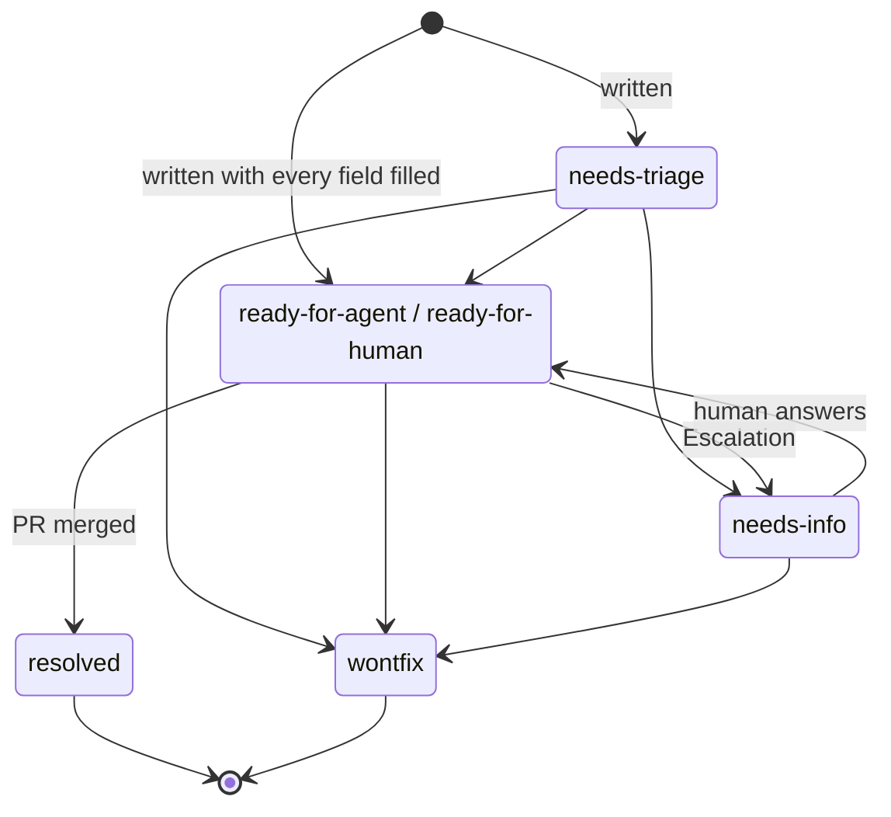

# Ticket lifecycle

A Ticket's `**Status:**` line is its state. The values are the five labels in [triage labels](../agents/triage-labels.md) plus `resolved`. The field order of a Ticket is in the [ticket template](../workflow/ticket-template.md).

## Who may move a Ticket

| From                                   | To                                     | Who                                                                                                                                                      |
| -------------------------------------- | -------------------------------------- | -------------------------------------------------------------------------------------------------------------------------------------------------------- |
| (new)                                  | `needs-triage`                         | Whoever writes the Ticket.                                                                                                                               |
| (new)                                  | `ready-for-agent` or `ready-for-human` | The writer, only if every template field is filled. The human's merge of the Ticket PR is the approval.                                                  |
| `needs-triage`                         | any label, or `wontfix`                | The human. An agent may propose a Status with `triage`.                                                                                                  |
| `ready-for-agent` or `ready-for-human` | `needs-info`                           | The agent working the Ticket ([escalation](../workflow/escalation.md)), or the human.                                                                    |
| `needs-info`                           | `ready-for-agent` or `ready-for-human` | The human only.                                                                                                                                          |
| `ready-for-agent`                      | `ready-for-human`, and back            | The human only.                                                                                                                                          |
| `ready-for-agent` or `ready-for-human` | `resolved`                             | The Actor implementing it, in the last commit of its PR ([definition of done](../workflow/definition-of-done.md)). It counts only once the PR is merged. |
| any                                    | `wontfix`                              | The human only.                                                                                                                                          |
| `resolved`                             | anything                               | Nobody. Follow-up work is a new Ticket.                                                                                                                  |

## Taken Tickets

There is no "in progress" Status. A Ticket is taken when its Task Branch (`agent/NNNNN-NN-<slug>`) or draft PR exists. The Orchestrator assigns Tickets, so two agents never start the same one.

## Spec status

A Spec's `spec.md` also has a `Status:` line. It is `ready-for-agent` once the Spec is on `main`, and it is set to `resolved` through a task PR when every Ticket is `resolved` ([git workflow](../workflow/git-workflow.md#finishing-the-feature)).
